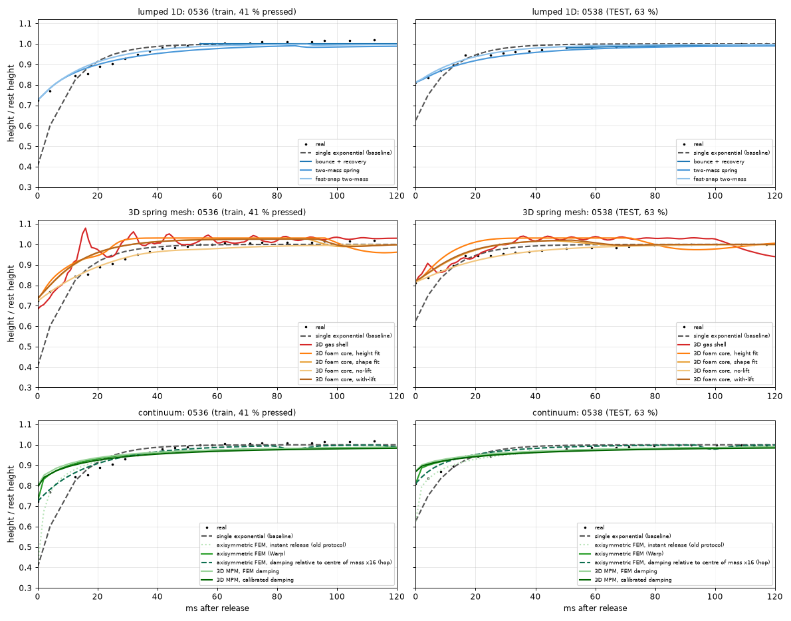

# Teaching a computer how a foam ball squashes, from video

I filmed a yellow foam ball being pressed by a steel tin and let go, then built simulations of the ball that reproduce what the camera saw. The simulations were set up using two clips and then **tested on two clips they had never seen**.

This is a take-home project for Dirac Robotics (Research Engineer Intern). The brief: fit a simple 3D deformation model of one soft object from video, demonstrate it on a fresh instance of the same interaction, and compare it with the real behaviour.

## The result in 30 seconds
After the tin lets go, the real ball springs back to its original height in about **25-40 ms** (a few video frames at 240 fps). The best models predict the ball's height over the following 250 ms to within **1-2 % of its height** (about 1 mm on a 67 mm ball) on the held-out clips. Guessing "it eases back exponentially" gives 3.3 %.



**Watch these first** (real clip on the left, model on the right, same clock, slowed 8x; the clip is 0538, which was held out):
- [Finite-element ball, with the hop](models/continuum/fem_relative_damping_hop/outputs/real_vs_fem_hop16_IMG_0538.mp4)
- [Finite-element ball, without the hop](models/continuum/fem_axisymmetric_warp/outputs/real_vs_fem_IMG_0538.mp4)

All videos are listed in [docs/videos.md](docs/videos.md). Terms explained in plain words: [docs/glossary.md](docs/glossary.md).

## What I did, in four steps
1. **Measure the video** ([tracking/](tracking/README.md)). Find the ball in every frame (a colour threshold, cross-checked with Meta's pretrained SAM 2 segmentation model) and record its top edge, bottom edge, width and outline over time.
2. **Choose a model of the ball's physics.** I tried three families, from simple to detailed, so the choice is not a guess.
3. **Fit the model's few numbers** (stiffness, damping, friction) so it matches the two training clips. This is ordinary curve fitting of physical constants. **There is no neural network in the models**; the only network is SAM 2, used for tracking.
4. **Predict the held-out clips and compare** every model on the same measurements ([evaluation/model_comparison](evaluation/model_comparison/README.md)).

The tin's motion is an *input* taken from the video (it is the thing pushing the ball); the models predict how the ball responds after the tin lets go, plus its outline.

## Which model should I look at?
Models are grouped in three families under [models/](models/). Height error is on the **held-out clips** (lower is better; the simple exponential guess scores 3.3 %).

| Model | In plain words | Height error | Look at it if you want... |
| --- | --- | --- | --- |
| [FEM, default](models/continuum/fem_axisymmetric_warp/README.md) | the ball as a smooth elastic solid, fitted to real material numbers (stiffness 38 kPa, Poisson ratio 0.10) | 1.7 % | the main physical model |
| [FEM with the hop](models/continuum/fem_relative_damping_hop/README.md) | the same ball with damping that lets it bounce off the table like the real one | **1.4 %** | the most accurate model that also hops; includes the damping-factor study |
| [MPM](models/continuum/mpm_3d_warp/README.md) | the ball as a cloud of 80,000 particles, in full 3D | 2.0 % | other loads: a point poke and two side plates (not validated against video) |
| [Fast-snap two-mass](models/lumped_1d/fast_snap/README.md) | two blobs and a spring; the simplest model that works | 1.1 % | how far a very simple model gets |

The other eight models (1D spring models, 3D spring meshes) are the earlier attempts; they are compared in [evaluation/model_comparison](evaluation/model_comparison/README.md), including a one-page scorecard and plots of every aspect (height, recovery time, shape, hop, speed). The spread among the best models (1.1-2.0 %) is about the size of the tracking noise, so they cannot be ranked on height alone; the continuum models add physical constants that do not depend on the mesh, a smooth ball, and a route to other loads.

## Repository map
```
tracking/     step 1: video -> measurements (colour tracker and SAM 2)
models/       steps 2-3: one folder per model, each with README (formulas, parameters, limits), src/, outputs/, run.sh
  lumped_1d/    the ball as one or two vertical bodies (3 models)
  mesh_3d/      3D mass-spring surface mesh (5 models)
  continuum/    elastic solid: finite elements, the hop variant, material point method (3 models; NVIDIA Warp + PyTorch)
evaluation/   step 4: all models compared on the same footing (tables, 7 figures)
shared/       code several models import
docs/         assignment, glossary, video gallery, the correction note
archive/      superseded earlier work, kept for the record
```
**How to read it:** 5 minutes: this page and the two videos. 15 minutes: add [the comparison](evaluation/model_comparison/README.md) and one model README. Deep dive: [continuum/README](models/continuum/README.md), then the FEM and hop READMEs.

## Run it
```bash
# needs python3, ffmpeg and the four originals in videos/IMG_053{6,7,8,9}.MOV (not in git, ~157 MB)
./run_all.sh              # ~30 min: tracking, all models from saved parameters, videos, comparison
./run_all.sh --fit-3d     # also refit the 3D mesh models and the FEM (each ~10-20 min)
```
The continuum models use a second environment (`.venv-sim`: Warp, PyTorch, SAM 2; built automatically by `env_sim.sh`; a GPU is recommended). Clips: 0536 and 0537 are training (deep squeezes, ball pressed to 36-41 % of its height); 0538 and 0539 are held out (shallow squeezes, 62-63 %).

## Assumptions and limitations (read before relying on any number)
- **Only flat-plate presses were fitted and tested.** The point-poke and side-plate loads (MPM, spring meshes) are predictions with no video to check them against.
- **The tin's motion is an input** from the video; the models do not predict how the tin moves.
- **Ball mass was not measured** (assumed density 55 kg/m³, mass about 10 g; stiffness scales linearly with it) and the 6.7 cm diameter is approximate; it sets the pixel scale.
- **Four clips only** (two training, two held out): the numbers are a rough spread, not a confidence interval.
- **The hop is the weakest part.** The default continuum models do not hop at all. The hop variant gets its size right (4-8 mm against 3-7 mm) but it starts about 5 ms after release while the real hop starts about 20 ms after, and its damping multiplier (×16) was chosen on a coarse grid from two clips. Details in its README.
- **Spring-mesh parameters depend on the mesh;** the continuum constants should not.
- **Fit status:** the gas-shell fit never left its starting values; the no-lift fit ended with one stiffness on its bound; mesh fits use two or three starting points.
- **Tracking:** one fixed table line and camera pose; the cause of the uneven frame gaps in the files is not verified (file timestamps are used).
- **Input videos are not in git** (size). They are the four originals named above.

## One correction worth knowing about
An early version took the wrong frame as "the moment the tin lets go" (the ball was still riding on the tin), which made every model look too fast. It was found, fixed by driving the measured tin motion in every simulator, and **every model was refitted**. Details: [docs/correction_release_definition.md](docs/correction_release_definition.md); the old outputs are in [archive/](archive/README.md).

## Credits
Python, NumPy, SciPy, OpenCV, Matplotlib, FFmpeg; NVIDIA Warp (simulation), PyTorch (fitting), Meta's SAM 2 (`facebook/sam2.1-hiera-tiny`, via Hugging Face) for segmentation. Code and analysis were written with Claude Code (Anthropic's AI assistant); results were checked by running the pipelines.
